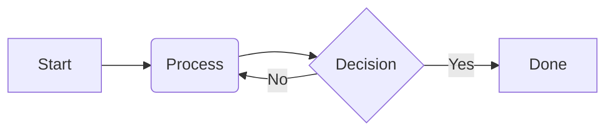
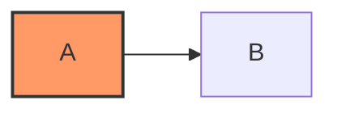

:::warning
Este documento é um trabalho em progresso.
:::

Nossos sites suportam a criação de conteúdo em [Markdown][],
com algumas adições do [GitHub Flavored Markdown][]
bem como outras sintaxes personalizadas.

Esta página descreve a sintaxe Markdown que suportamos
bem como nossas diretrizes de estilo para criar Markdown.

[Markdown]: https://commonmark.org/
[GitHub Flavored Markdown]: https://github.github.com/gfm/

## Diretrizes gerais

Prefira usar sintaxe Markdown ao invés de HTML e componentes personalizados.
Markdown puro é mais fácil de manter, mais fácil para ferramentas entenderem,
e mais fácil de migrar no futuro se necessário.

## Blocos de código

Não use blocos de código indentados do Markdown,
use apenas blocos de código cercados usando backticks
e sempre especifique uma linguagem. Por exemplo:

````markdown
```dart
void main() {
  print('Hello world!');
}
```
````

Para aprender mais sobre personalização de blocos de código,
confira a documentação dedicada sobre [Blocos de código][].

[Blocos de código]: /contribute/docs/code-blocks


## Diagramas Mermaid

Para renderizar fluxogramas, diagramas de sequência e outros gráficos em um arquivo Markdown,
use um bloco de código delimitado com o identificador de linguagem `mermaid`:

````markdown

````

### Estilizar diagramas Mermaid

Os diagramas Mermaid são renderizados para SVG no servidor, uma vez para cada tema.
Ambas as variantes são incluídas na página e o CSS mostra a que corresponde ao
tema claro ou escuro atual do site. Os diagramas herdam a tipografia
padrão `Google Sans Flex`.

#### Estilização no diagrama (Recomendado)

Quando você precisar de cores personalizadas para nós específicos,
defina-as diretamente no diagrama usando a
[sintaxe `classDef` e `:::styleName`][`classDef` and `:::styleName` syntax] nativa do Mermaid:



#### Estilização SCSS

Para ajustar o layout global, a borda ou o fundo dos diagramas em todo o site,
edite [`_mermaid.scss`][]:

```scss
.mermaid-container {
  // Container styling (padding, margins, background, border)

  // Fallback shown only if server rendering the diagram failed
  pre.mermaid {
    // Fallback styles
  }
  
  .mermaid-theme {}

  .mermaid-theme-light {}

  .mermaid-theme-dark {}

  svg {
    // Custom SVG element overrides (requires !important)
  }
}
```

[`classDef` and `:::styleName` syntax]: https://mermaid.js.org/syntax/flowchart.html#styling-and-classes
[`_mermaid.scss`]: https://github.com/flutter/website/blob/main/packages/site_shared/lib/_sass/components/_mermaid.scss
