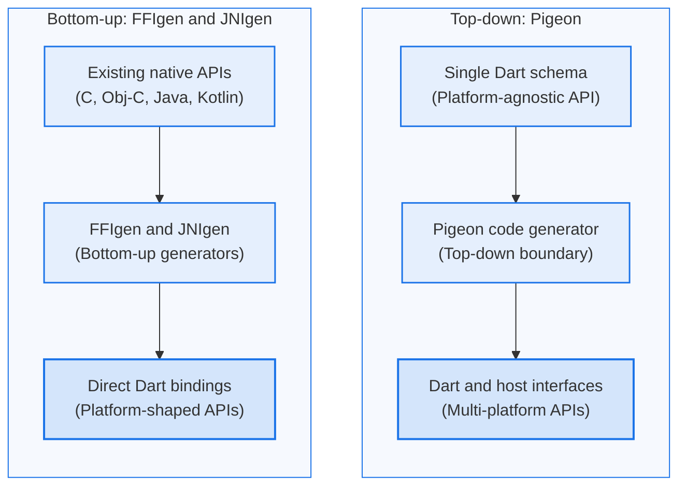

Apps Flutter rodam em várias plataformas,
mas às vezes você precisa se comunicar diretamente
com o sistema operacional hospedeiro ou executar código de uma biblioteca nativa existente.

Para isso, o Flutter oferece várias ferramentas de interop,
desde geradores de código até bindings FFI diretos.

## Visão geral das ferramentas de interop {:#overview-of-interop-tools}

As ferramentas de interop do Flutter adotam uma de duas abordagens arquiteturais
para fazer a ponte entre Dart e código nativo.
FFIgen e JNIgen usam uma abordagem bottom-up, que parte de APIs nativas
existentes e gera bindings Dart que espelham essas APIs diretamente.
Pigeon usa uma abordagem top-down, que parte de um único schema Dart
e gera interfaces cliente e host correspondentes em várias plataformas.
Escolha a abordagem que melhor se adapta às necessidades da sua integração.

### Bottom-up com FFIgen e JNIgen {:#bottom-up-with-ffigen-and-jnigen}

FFIgen e JNIgen geram bindings Dart de baixo nível diretamente a partir
dos headers ou das classes da plataforma de destino.
Como os bindings gerados chamam código nativo sem overhead de serialização,
você é responsável por gerenciar o tempo de vida da memória nativa
e a concorrência no seu código Dart.

- [FFIgen](/interop/ffigen) analisa headers de C e Objective-C
  (incluindo Swift anotado com `@objc`) para gerar
  bindings diretos de [`dart:ffi`](/interop/dart-ffi).
  Envolver um framework de iOS ou macOS com o FFIgen produz uma API Dart
  com formato Apple; envolver uma biblioteca C ou um binário com ABI C
  (C, C++ com `extern "C"`, Rust ou Go) produz uma API Dart com formato C.
- [JNIgen](/interop/jnigen) inspeciona classes Java e Kotlin,
  arquivos JAR e AAR ou pacotes do Android SDK para gerar
  bindings JNI diretos.
  Envolver um pacote Android com o JNIgen produz uma API Dart
  com formato Android.

### Top-down com Pigeon {:#top-down-with-pigeon}

[Pigeon](/interop/pigeon) parte de um único schema Dart que define,
uma única vez, um contrato de fronteira intencional e independente de plataforma,
e garante tipos e assinaturas idênticos entre Android, iOS, macOS,
Windows e Linux.
Você implementa a interface host gerada em cada plataforma de destino,
enquanto o Pigeon cuida da segurança de tipos, da conversão de dados
e da segurança de memória entre runtimes na fronteira.

O Pigeon gera bindings sobre
[platform channels](/platform-integration/platform-channels)
para todas as plataformas suportadas e oferece uma opção de prévia
para gerar bindings de interop nativa direta usando o [FFIgen](/interop/ffigen)
no iOS e no macOS e o [JNIgen](/interop/jnigen) no Android.

## Empacote seu código de interop {:#package-your-interop-code}

Dependendo de como você pretende compartilhar seu código,
escolha a opção que melhor se adapta ao seu caso de uso.
Para entender a diferença entre um [package](/resources/glossary#package)
e um [plugin](/resources/glossary#plugin),
consulte o [glossário do Flutter](/resources/glossary).

- **Integração no próprio app.**
  Escreva seu código de interop nativo diretamente dentro do seu app Flutter,
  sem criar um package separado.
- **Plugin.**
  Um package especializado que disponibiliza funcionalidades nativas da plataforma
  (como a câmera ou os sensores de um dispositivo) para o seu app
  (`flutter create --template=plugin`).
  Para mais detalhes, consulte
  [Desenvolvendo packages de plugin](/packages-and-plugins/developing-packages#plugin).
- **Package FFI.**
  Um package que compila e empacota código nativo em C ou C++
  (ou binários pré-compilados) usando [build hooks do Dart](/interop/bind-native-code)
  e [`dart:ffi`](/interop/dart-ffi).
  Este template também inclui uma configuração do FFIgen para regenerar
  os bindings Dart (`flutter create --template=package_ffi`).
  Para mais detalhes, consulte
  [Desenvolvendo packages FFI](/packages-and-plugins/developing-packages#ffi).

Para mais detalhes sobre a criação de packages,
consulte [Desenvolvendo packages e plugins](/packages-and-plugins/developing-packages).

## Comparação de ferramentas {:#tool-comparison}

A tabela a seguir compara duas soluções de interop:

- **Interop direta:** bindings diretos de nível mais baixo, com maior desempenho
  para grandes volumes de dados; exige gerenciamento manual de memória e concorrência.
- **Pigeon:** gerador de código estruturado e com segurança de tipos
  para contratos de fronteira multiplataforma.

| Linguagem de destino | Interop direta | Pigeon |
| --- | --- | --- |
| **C** | [FFIgen](/interop/ffigen) | Suportado no Linux (GObject) com platform channels |
| **C++ com `extern "C"`** | [FFIgen](/interop/ffigen) | Suportado no Windows com platform channels |
| **C++ sem `extern "C"`** | FFIgen (ainda não suportado) | Suportado no Windows com platform channels |
| **Rust com `extern "C"`** | [FFIgen](/interop/ffigen) | Não suportado diretamente |
| **Rust sem `extern "C"`** | [Flutter Rust Bridge][frb] | Não suportado |
| **Go com `extern "C"`** | [FFIgen](/interop/ffigen) | Não suportado diretamente |
| **Go sem `extern "C"`** | Não suportado | Não suportado |
| **Java** | [JNIgen](/interop/jnigen) | Suportado com platform channels, ou via Kotlin com interop nativa (prévia) |
| **Kotlin** | [JNIgen](/interop/jnigen) | Suportado com platform channels ou interop nativa (prévia) |
| **Objective-C** | [FFIgen](/interop/ffigen) | Suportado com platform channels, ou via Swift com interop nativa (prévia) |
| **Swift sem anotações de compatibilidade com Obj-C** | [`package:swiftgen`][swiftgen-pub] (experimental) | Suportado com platform channels ou interop nativa (prévia) |

{:.table .table-striped}

## Entenda as camadas de interop {:#understand-interop-layers}

O Dart organiza a interop nativa em três camadas distintas:
bindings de baixo nível, APIs Dart idiomáticas e plugins específicos do framework.

Para detalhes completos da arquitetura,
consulte o [guia de camadas de interop nativa][interop-layers].

### Camada 1: bindings de baixo nível {:#layer-1-low-level-bindings}

A camada 1 é composta por wrappers finos, de alto desempenho e sem opinião
sobre o código nativo (por exemplo, [`dart:ffi`](/interop/dart-ffi),
`dart:js_interop`, [FFIgen](/interop/ffigen)
e [JNIgen](/interop/jnigen)).
Essas APIs espelham de perto as assinaturas nativas,
mas exigem gerenciamento manual de memória e de concorrência.

### Camada 2: APIs Dart idiomáticas {:#layer-2-idiomatic-dart-apis}

A camada 2 é composta por APIs Dart idiomáticas que envolvem a camada de baixo nível
para ocultar complexidades específicas de cada plataforma (por exemplo,
[Pigeon](/interop/pigeon) ou o [package `sqlite3`][sqlite3-pub]).
Elas gerenciam automaticamente a concorrência, o tempo de vida da memória
e as conversões de dados.

### Camada 3: plugins específicos do framework {:#layer-3-framework-specific-plugins}

A camada 3 oferece integração com APIs específicas do framework (por exemplo,
a API de Plugins do Flutter).
Essa camada expõe APIs Dart para o framework e oculta detalhes da plataforma,
como o `Context` do Android ou o ciclo de vida de aplicações do iOS.

[frb]: {{site.pub-pkg}}/flutter_rust_bridge
[swiftgen-pub]: {{site.pub-pkg}}/swiftgen
[sqlite3-pub]: {{site.pub-pkg}}/sqlite3
[interop-layers]: https://github.com/dart-lang/native/blob/main/doc/interop-layers.md
